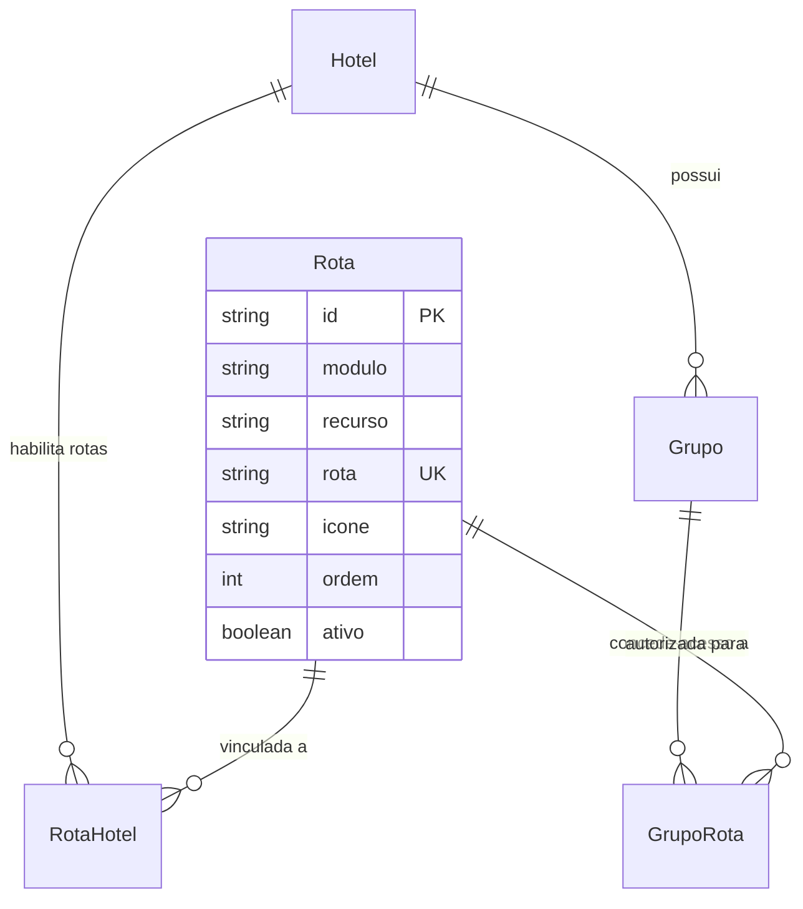

# Data Model: Catálogo e Sincronização Idempotente de Rotas e Permissões do Sistema

## 1. Estrutura do Item de Seed (`RouteSeedItem`)

Cada entrada do catálogo `BASE_ROUTES` possui a tipagem:

```typescript
interface RouteSeedItem {
  modulo: string
  recurso: string
  rota: string
  icone: string
  ordem: number
}
```

## 2. Catálogo Oficial Canônico (`BASE_ROUTES`)

| Módulo | Recurso | Rota | Ícone | Ordem |
|---|---|---|---|---|
| `Dashboard` | `Dashboard` | `/` | `LayoutDashboard` | `0` |
| `Quartos` | `Cadastrar` | `/quartos/novo` | `BedDouble` | `10` |
| `Quartos` | `Consultar` | `/quartos` | `BedDouble` | `11` |
| `Quartos` | `Categorias` | `/categorias_quartos` | `BedDouble` | `12` |
| `Tarifários` | `Cadastrar` | `/tarifarios/novo` | `CalendarRange` | `20` |
| `Tarifários` | `Consultar` | `/tarifarios` | `CalendarRange` | `21` |
| `Usuários` | `Cadastrar` | `/usuarios/novo` | `Users` | `30` |
| `Usuários` | `Consultar` | `/usuarios` | `Users` | `31` |
| `Grupos` | `Cadastrar` | `/grupos/novo` | `Shield` | `40` |
| `Grupos` | `Consultar` | `/grupos` | `Shield` | `41` |

## 3. Modelo de Entidades e Relacionamentos no Prisma



## 4. Regras de Integridade e Invariantes

1. **Unicidade de Rota**: O campo `rota` em `Rota` é único globalmente no sistema.
2. **Idempotência**: Execuções consecutivas de `seedRoutes` não criam registros duplicados em `Rota`, `RotaHotel` nem `GrupoRota`.
3. **Preservação de Histórico**: Rotas obsoletas recebem `ativo: false`, sem exclusão física das linhas.
