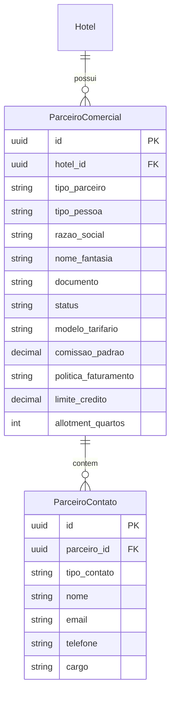
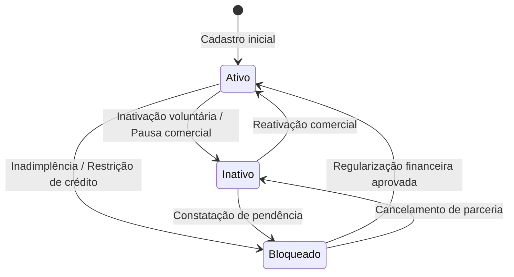

# Data Model: Gestão de Parceiros Comerciais

**Feature**: `024-commercial-partners`  
**Date**: 2026-11-04  
**Context**: Modelo de dados relacional e entidades de domínio para suporte ao módulo Comercial no HotelMind.

---

## 1. Entidades de Domínio

### 1.1 `ParceiroComercial`
Representa a pessoa jurídica ou física que intermedeia, emite reservas ou fatura diretamente com o hotel.

| Campo | Tipo | Nulável | Descrição |
| :--- | :--- | :--- | :--- |
| `id` | UUID | Não | Identificador único universal |
| `hotel_id` | UUID | Não | Identificador do hotel (multi-tenancy) |
| `tipo_parceiro` | Enum | Não | Classificação (`agente_autonomo`, `agencia_viagens`, `operadora_turismo`, `clube_turismo`, `empresa_corporativa`) |
| `tipo_pessoa` | Enum | Não | Pessoa Física (`PF`) ou Jurídica (`PJ`) |
| `razao_social` | String(150) | Não | Razão Social (PJ) ou Nome Completo (PF) |
| `nome_fantasia` | String(150) | Sim | Nome Fantasia comercial ou nome profissional do agente |
| `documento` | String(20) | Sim | CPF (PF) ou CNPJ (PJ) limpo (apenas dígitos). Opcional para parceiros internacionais |
| `inscricao_estadual` | String(30) | Sim | Inscrição Estadual (PJ) |
| `estrangeiro` | Boolean | Não | Define se o parceiro é sediado fora do Brasil (padrão `false`) |
| `cadastur` | String(30) | Sim | Registro no Ministério do Turismo (CADASTUR) |
| `codigo_iata` | String(20) | Sim | Código de credenciamento IATA / IATAN |
| `registro_embratur` | String(30) | Sim | Código histórico/institucional Embratur |
| **Endereço** | | | |
| `logradouro` | String(120) | Sim | Rua, avenida, alameda |
| `numero` | String(20) | Sim | Número do imóvel |
| `complemento` | String(50) | Sim | Andar, sala, bloco |
| `bairro` | String(60) | Sim | Bairro ou distrito |
| `cidade` | String(60) | Sim | Município |
| `estado` | String(2) | Sim | UF (ex.: SP, RJ) ou província |
| `cep` | String(10) | Sim | CEP (formato 00000-000 ou 8 dígitos) ou ZipCode |
| `pais` | String(50) | Não | País de domicílio (padrão `Brasil`) |
| **Regras Comerciais** | | | |
| `modelo_tarifario` | Enum | Não | `net`, `comissionada`, `acordo` |
| `comissao_padrao` | Decimal(5,2) | Não | Percentual de comissão (0.00 a 100.00, padrão 0.00) |
| `politica_faturamento` | Enum | Não | `voucher`, `faturado`, `prepago` |
| `prazo_pagamento_dias`| Int | Não | Dias para pagamento após checkout/faturamento (padrão 0) |
| `limite_credito` | Decimal(12,2)| Não | Limite máximo em moeda corrente para faturamento a prazo (padrão 0.00) |
| `allotment_quartos` | Int | Não | Cota contratual de quartos bloqueados (padrão 0) |
| **Ciclo de Vida** | | | |
| `status` | Enum | Não | `ativo`, `inativo`, `bloqueado` (padrão `ativo`) |
| `motivo_bloqueio` | String | Sim | Descrição do motivo caso esteja bloqueado |
| `observacoes` | Text | Sim | Notas operacionais, restrições e acordos |
| `criado_em` | DateTime | Não | Timestamp de criação |
| `atualizado_em` | DateTime | Não | Timestamp de última alteração |

---

### 1.2 `ParceiroContato`
Pessoas de contato vinculadas ao parceiro comercial.

| Campo | Tipo | Nulável | Descrição |
| :--- | :--- | :--- | :--- |
| `id` | UUID | Não | Identificador único do contato |
| `parceiro_id` | UUID | Não | Referência para `ParceiroComercial` |
| `tipo_contato` | Enum | Não | Finalidade do contato (`comercial`, `financeiro`, `operacional`) |
| `nome` | String(100) | Não | Nome da pessoa de contato |
| `email` | String(150) | Não | E-mail corporativo ou de contato |
| `telefone` | String(30) | Não | Telefone comercial fixo ou celular / WhatsApp |
| `cargo` | String(50) | Sim | Cargo ou departamento da pessoa |
| `criado_em` | DateTime | Não | Timestamp de inclusão |

---

## 2. Diagrama de Relacionamento e Estados



### Transições de Estado de `ParceiroComercial`



---

## 3. Modelo Prisma (`schema.prisma`)

```prisma
model ParceiroComercial {
  id                    String             @id @default(uuid())
  hotel_id              String
  tipo_parceiro         String             @db.VarChar(30)
  tipo_pessoa           String             @db.Char(2)
  razao_social          String             @db.VarChar(150)
  nome_fantasia         String?            @db.VarChar(150)
  documento             String?            @db.VarChar(20)
  inscricao_estadual    String?            @db.VarChar(30)
  estrangeiro           Boolean            @default(false)
  cadastur              String?            @db.VarChar(30)
  codigo_iata           String?            @db.VarChar(20)
  registro_embratur     String?            @db.VarChar(30)

  // Endereço
  logradouro            String?            @db.VarChar(120)
  numero                String?            @db.VarChar(20)
  complemento           String?            @db.VarChar(50)
  bairro                String?            @db.VarChar(60)
  cidade                String?            @db.VarChar(60)
  estado                String?            @db.VarChar(2)
  cep                   String?            @db.VarChar(10)
  pais                  String             @default("Brasil") @db.VarChar(50)

  // Regras Comerciais
  modelo_tarifario      String             @default("comissionada") @db.VarChar(20)
  comissao_padrao       Decimal            @default(0.00) @db.Decimal(5, 2)
  politica_faturamento  String             @default("prepago") @db.VarChar(20)
  prazo_pagamento_dias  Int                @default(0)
  limite_credito        Decimal            @default(0.00) @db.Decimal(12, 2)
  allotment_quartos     Int                @default(0)

  // Ciclo de vida e observações
  status                String             @default("ativo") @db.VarChar(20)
  motivo_bloqueio       String?            @db.Text
  observacoes           String?            @db.Text
  criado_em             DateTime           @default(now())
  atualizado_em         DateTime           @updatedAt

  hotel                 Hotel              @relation(fields: [hotel_id], references: [id], onDelete: Cascade)
  contatos              ParceiroContato[]

  @@unique([hotel_id, documento])
  @@index([hotel_id])
  @@index([hotel_id, tipo_parceiro])
  @@index([hotel_id, status])
  @@index([hotel_id, razao_social])
  @@map("parceiros_comerciais")
}

model ParceiroContato {
  id           String            @id @default(uuid())
  parceiro_id  String
  tipo_contato String            @db.VarChar(20)
  nome         String            @db.VarChar(100)
  email        String            @db.VarChar(150)
  telefone     String            @db.VarChar(30)
  cargo        String?           @db.VarChar(50)
  criado_em    DateTime          @default(now())

  parceiro     ParceiroComercial @relation(fields: [parceiro_id], references: [id], onDelete: Cascade)

  @@index([parceiro_id])
  @@index([parceiro_id, tipo_contato])
  @@map("parceiros_contatos")
}
```

---

## 4. Regras de Validação e Consistência

1. **CPF e CNPJ**:
   - `tipo_pessoa === 'PF'`: Se preenchido, `documento` deve conter 11 dígitos numéricos válidos após cálculo de dígitos verificadores (módulo 11).
   - `tipo_pessoa === 'PJ'`: Se preenchido, `documento` deve conter 14 dígitos numéricos válidos após cálculo de dígitos verificadores.
   - `estrangeiro === false`: `documento` é de preenchimento obrigatório.
   - `estrangeiro === true`: `documento` é opcional ou armazena o Tax ID internacional livre.
2. **Comissão Padrão**:
   - Deve ser maior ou igual a `0.00` e menor ou igual a `100.00`.
3. **Limite de Crédito**:
   - Deve ser maior ou igual a `0.00`. Se a política for `prepago`, o limite padrão é `0.00`.
4. **Allotment de Quartos**:
   - Inteiro maior ou igual a `0`.
5. **Prazo de Pagamento**:
   - Inteiro maior ou igual a `0`.
