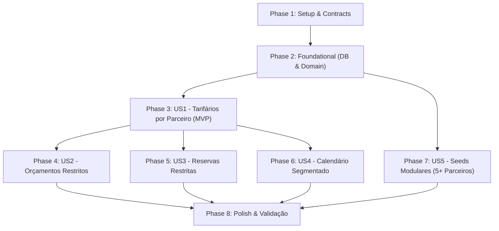

# Tasks: Tarifários Vinculados a Parceiros Comerciais

**Input**: Design documents from `/specs/027-partner-rate-plans/`

**Prerequisites**: [plan.md](plan.md), [spec.md](spec.md), [research.md](research.md), [data-model.md](data-model.md), [contracts/](contracts/)

**Tests**: Test-Driven Development (TDD) é obrigatório conforme as diretrizes do HotelMind (testes unitários com fakes in-memory e testes de integração com `app.inject()`).

**Organization**: Tarefas agrupadas por User Story para possibilitar implementação e testes independentes de cada entrega.

## Format: `[ID] [P?] [Story] Description`

- **[P]**: Tarefa paralelizada (arquivos distintos, sem dependência mútua)
- **[Story]**: Identificador da User Story correspondente (US1, US2, US3, US4, US5)
- Caminhos completos dos arquivos indicados em cada descrição

---

## Phase 1: Setup & Contracts (Shared Infrastructure)

**Purpose**: Definição dos tipos, DTOs e contratos em `.contracts` antes de qualquer implementação.

- [X] T001 [P] Atualizar contratos compartilhados em `packages/.contracts/src/tarifarios.ts` adicionando `parceiro_id?: string | null`, DTOs de listagem com filtro de parceiro e campos de parceiro resumido.
- [X] T002 [P] Atualizar contratos compartilhados em `packages/.contracts/src/orcamentos.ts` adicionando `parceiro_id?: string | null` na entidade `Orcamento`, `CreateOrcamentoPayload` e `UpdateOrcamentoPayload`.
- [X] T003 [P] Atualizar contratos compartilhados em `packages/.contracts/src/reservas.ts` adicionando `parceiro_id?: string | null` nos parâmetros de consulta de disponibilidade (`ConsultarDisponibilidadeParams`).
- [X] T004 Re-exportar e validar tipagem central em `packages/.contracts/src/index.ts`.

---

## Phase 2: Foundational (Database & Base Domain Architecture)

**Purpose**: Estrutura do banco de dados, repositórios base e serviços compartilhados que bloqueiam as User Stories.

**⚠️ CRITICAL**: Nenhuma User Story deve iniciar antes da conclusão deste portão.

- [X] T005 Atualizar o schema do Prisma em `packages/api/src/prisma/schema.prisma` adicionando `parceiro_id String?` nos modelos `Tarifario` e `Orcamento` com relações `@relation` e índices `@@index([hotel_id, parceiro_id])` e `@@index([hotel_id, parceiro_id, ativo])`.
- [X] T006 Executar geração do cliente Prisma e migração de banco via `pnpm --filter api db:migrate` gerando o artefato de migração em `packages/api/src/prisma/migrations/`.
- [X] T007 [P] Atualizar entidade de domínio `Tarifario` em `packages/api/src/core/entities/tarifario.ts` e testes unitários em `packages/api/src/core/entities/tarifario.spec.ts` suportando `parceiro_id`.
- [X] T008 [P] Atualizar entidade de domínio `Orcamento` em `packages/api/src/core/entities/orcamento.ts` e testes unitários em `packages/api/src/core/entities/orcamento.spec.ts` suportando `parceiro_id`.
- [X] T009 [P] Atualizar interface de repositório e fake in-memory em `packages/api/src/core/repositories/tarifarios/tarifario.repository.ts` e `packages/api/src/core/repositories/tarifarios/in-memory/in_memory_tarifario_repository.ts` suportando filtro e persistência de `parceiro_id`.
- [X] T010 [P] Atualizar repositório Prisma de tarifários em `packages/api/src/core/repositories/tarifarios/implementation/postgres_tarifario_repository.ts` implementando consultas por `parceiro_id`.
- [X] T011 [P] Atualizar interface de repositório e fake in-memory em `packages/api/src/core/repositories/orcamentos/orcamento_repository.ts` e `packages/api/src/core/repositories/orcamentos/in-memory/in_memory_orcamento_repository.ts` suportando `parceiro_id`.
- [X] T012 [P] Atualizar repositório Prisma de orçamentos em `packages/api/src/core/repositories/orcamentos/implementation/postgres_orcamento_repository.ts` implementando persistência e busca de `parceiro_id`.
- [X] T013 Atualizar `TarifarioPricingService` em `packages/api/src/core/services/tarifario_pricing_service.ts` e testes em `packages/api/src/core/services/tarifario_pricing_service.spec.ts` para suportar segregação estrita de tarifas por parceiro comercial.

**Checkpoint**: Camada base e persistência prontas. As User Stories podem prosseguir.

---

## Phase 3: User Story 1 - Cadastro e Gestão de Tarifário Vinculado a Parceiro (Priority: P1) 🎯 MVP

**Goal**: Permitir cadastrar e editar tarifários vinculados opcionalmente a um parceiro comercial ativo no hotel, mantendo tarifários sem parceiro como públicos gerais.

**Independent Test**: Criar um tarifário selecionando um parceiro comercial, persistir e verificar que o vínculo foi salvo e que o tarifário pode ser consultado filtrando por aquele parceiro.

### Tests for User Story 1

- [X] T014 [P] [US1] Escrever testes unitários em `packages/api/src/core/usecases/tarifarios/tarifarios_use_cases.spec.ts` para criação, edição e consulta de tarifários com `parceiro_id`.
- [X] T015 [P] [US1] Escrever testes unitários para schemas Zod em `packages/api/src/schemas/tarifarios/tarifarios_schema.spec.ts` validando o campo opcional `parceiro_id`.

### Implementation for User Story 1

- [X] T016 [P] [US1] Atualizar use cases `CriarTarifarioUseCase` e `EditarTarifarioUseCase` em `packages/api/src/core/usecases/tarifarios/criar_tarifario_use_case.ts` e `packages/api/src/core/usecases/tarifarios/editar_tarifario_use_case.ts` validando existência e status do parceiro.
- [X] T017 [P] [US1] Atualizar schemas Zod de tarifários em `packages/api/src/schemas/tarifarios/tarifarios_schema.ts`.
- [X] T018 [US1] Atualizar rotas Fastify de tarifários em `packages/api/src/routes/tarifarios/tarifarios_routes.ts` e testes de integração em `packages/api/src/routes/tarifarios/tarifarios_routes.spec.ts`.
- [X] T019 [P] [US1] Atualizar serviço de API do frontend em `packages/web/src/api/tarifarios.service.ts` e schema frontend em `packages/web/src/schemas/tarifarios/tarifario_schema.ts`.
- [X] T020 [US1] Atualizar componente `TarifarioForm` em `packages/web/src/components/tarifarios/tarifario_form.tsx` e testes em `packages/web/src/components/tarifarios/tarifario_form.spec.tsx` adicionando seleção de parceiro comercial (com opção "Tarifário Público").
- [X] T021 [US1] Atualizar páginas de criação e edição de tarifários em `packages/web/src/pages/app/tarifarios/novo.tsx` e `packages/web/src/pages/app/tarifarios/[id]/editar.tsx`.

**Checkpoint**: User Story 1 (MVP) concluída e testável de ponta a ponta.

---

## Phase 4: User Story 2 - Orçamento com Restrição de Tarifas e Suítes por Parceiro (Priority: P1)

**Goal**: Ao elaborar um orçamento informando um parceiro comercial, apresentar apenas as suítes e tarifas ativas acordadas para aquele parceiro. Se nenhum parceiro for informado, apresentar apenas tarifas públicas.

**Independent Test**: Criar um orçamento selecionando um parceiro comercial que possui tarifas cadastradas apenas para determinadas categorias/datas e comprovar que apenas essas categorias são calculáveis e exibidas.

### Tests for User Story 2

- [X] T022 [P] [US2] Escrever testes unitários em `packages/api/src/core/usecases/orcamentos/orcamentos_use_cases.spec.ts` validando a restrição de tarifas e cálculo exclusivo por parceiro comercial.
- [X] T023 [P] [US2] Escrever testes de integração em `packages/api/src/routes/orcamentos/orcamentos_routes.spec.ts` cobrindo criação e busca de orçamentos com parceiro.

### Implementation for User Story 2

- [X] T024 [US2] Atualizar `CriarOrcamentoUseCase`, `EditarOrcamentoUseCase` e `BuscarOrcamentoUseCase` em `packages/api/src/core/usecases/orcamentos/` garantindo que o cálculo de noites filtre tarifários ativos estritamente pelo `parceiro_id` informado.
- [X] T025 [P] [US2] Atualizar schemas Zod de orçamentos em `packages/api/src/schemas/orcamentos/orcamentos_schema.ts` com validação de `parceiro_id`.
- [X] T026 [US2] Atualizar rotas de orçamentos em `packages/api/src/routes/orcamentos/orcamentos_routes.ts` instanciando os use cases com o suporte ao parceiro comercial.
- [X] T027 [P] [US2] Atualizar serviço de API do frontend em `packages/web/src/api/orcamentos.service.ts` e schema frontend em `packages/web/src/schemas/orcamentos/orcamento.schema.ts`.
- [X] T028 [US2] Atualizar telas de orçamentos em `packages/web/src/pages/app/reservas/orcamentos/novo.tsx` e `packages/web/src/pages/app/reservas/orcamentos/[id]/editar.tsx` incluindo seleção de parceiro comercial e cálculo reativo que exibe apenas suítes cobertas pelas tarifas do parceiro.
- [X] T029 [US2] Atualizar testes de frontend em `packages/web/src/pages/app/reservas/orcamentos/orcamentos_pages.spec.tsx`.

**Checkpoint**: User Stories 1 e 2 funcionais e integradas.

---

## Phase 5: User Story 3 - Reserva com Restrição de Tarifas e Suítes por Parceiro (Priority: P1)

**Goal**: Ao selecionar um parceiro comercial na criação ou edição de uma reserva, restringir a disponibilidade de suítes e o cálculo de diárias estritamente às tarifas ativas daquele parceiro.

**Independent Test**: Consultar disponibilidade e criar uma reserva com parceiro comercial, garantindo que quartos de categorias sem tarifa do parceiro não apareçam na lista de disponíveis.

### Tests for User Story 3

- [X] T030 [P] [US3] Escrever testes unitários em `packages/api/src/core/usecases/reservas/consultar_disponibilidade_use_case.spec.ts` testando disponibilidade de quartos com e sem filtro de parceiro comercial.
- [X] T031 [P] [US3] Escrever testes unitários em `packages/api/src/core/usecases/reservas/criar_reserva_use_case.spec.ts` e `parceiro_reserva.spec.ts` validando integridade de precificação de parceiro.

### Implementation for User Story 3

- [X] T032 [US3] Atualizar `ConsultarDisponibilidadeUseCase` em `packages/api/src/core/usecases/reservas/consultar_disponibilidade_use_case.ts` para receber `parceiro_id?: string | null` e consultar apenas tarifários aplicáveis ao parceiro (ou públicos se nulo).
- [X] T033 [US3] Atualizar `CriarReservaUseCase` e `EditarReservaUseCase` em `packages/api/src/core/usecases/reservas/` para calcular as diárias estritamente com os tarifários do parceiro indicado.
- [X] T034 [P] [US3] Atualizar schemas Zod de reservas em `packages/api/src/schemas/reservas/reservas_schema.ts`.
- [X] T035 [US3] Atualizar rota de consulta de disponibilidade e criação de reservas em `packages/api/src/routes/reservas/reservas_routes.ts` e testes de integração em `packages/api/src/routes/reservas/reservas_routes.spec.ts`.
- [X] T036 [P] [US3] Atualizar serviço de API em `packages/web/src/api/reservas.service.ts` e schema frontend em `packages/web/src/schemas/reservas/reserva.schema.ts`.
- [X] T037 [US3] Atualizar tela de reserva em `packages/web/src/pages/app/reservas/nova.tsx` e `packages/web/src/pages/app/reservas/[id]/editar.tsx` conectando a mudança de parceiro comercial à query de disponibilidade (`reservas_disponibilidade`).
- [X] T038 [US3] Atualizar testes de frontend em `packages/web/src/pages/app/reservas/nova.spec.tsx` e `packages/web/src/pages/app/reservas/reservas_pages.spec.tsx`.

**Checkpoint**: User Stories 1, 2 e 3 funcionando de forma coesa.

---

## Phase 6: User Story 4 - Consulta de Tarifários e Calendário Segmentado por Parceiro (Priority: P2)

**Goal**: Permitir filtrar a listagem e o calendário de tarifários por parceiro comercial específico ou por tarifários públicos.

**Independent Test**: Aplicar o filtro de parceiro comercial na listagem e no calendário e verificar que somente as tarifas vinculadas a ele são apresentadas.

- [X] T039 [P] [US4] Atualizar use cases `ListarTarifariosUseCase` e `ConsultarPeriodosTarifariosUseCase` em `packages/api/src/core/usecases/tarifarios/` adicionando suporte a filtro por `parceiro_id`.
- [X] T040 [US4] Atualizar tela de listagem de tarifários em `packages/web/src/pages/app/tarifarios/index.tsx` adicionando filtro por parceiro comercial e badge visual de parceiro na tabela.
- [X] T041 [US4] Atualizar visualização de períodos em `packages/web/src/components/tarifarios/tarifario_calendar.tsx` e `packages/web/src/components/tarifarios/tarifario_calendar.spec.tsx` refletindo o contexto do parceiro selecionado.

---

## Phase 7: User Story 5 - Infraestrutura de Seeds Modular por Contexto e Carga de Testes (Priority: P2)

**Goal**: Separar os seeds de banco de dados por contexto e pasta, isolando o seed de rotas de produção e criando pelo menos 5 parceiros comerciais para testes.

**Independent Test**: Executar `pnpm --filter api db:seed:routes` e conferir que apenas rotas de produção são geradas; em seguida rodar `pnpm --filter api db:seed` e constatar a criação de 5 parceiros comerciais de teste com dados válidos.

- [X] T042 [US5] Criar o módulo isolado de produção em `packages/api/src/db/seeds/producao/rotas_seed.ts` contendo o cadastro idempotente de rotas e permissões sem qualquer dependência de dados mock de testes.
- [X] T043 [P] [US5] Atualizar `packages/api/src/db/seeds/routes_seed.ts` como wrapper/re-export apontando para `producao/rotas_seed.ts` mantendo retrocompatibilidade total com scripts existentes.
- [X] T044 [P] [US5] Criar módulo de semente de hotel e grupos base em `packages/api/src/db/seeds/desenvolvimento/hotel_seed.ts`.
- [X] T045 [P] [US5] Criar módulo de semente de acomodações e regimes em `packages/api/src/db/seeds/desenvolvimento/acomodacoes_seed.ts`.
- [X] T046 [US5] Criar módulo de semente de parceiros comerciais em `packages/api/src/db/seeds/desenvolvimento/parceiros_seed.ts` cadastrando pelo menos 5 parceiros comerciais diversificados (CVC, Booking, Decolar, Petrobras, Vale) com contatos e endereços completos.
- [X] T047 [US5] Criar módulo de semente de tarifários em `packages/api/src/db/seeds/desenvolvimento/tarifarios_seed.ts` gerando tanto tarifários públicos balcão quanto tarifários específicos vinculados aos parceiros comerciais de teste.
- [X] T048 [US5] Reestruturar o ponto de entrada principal de desenvolvimento em `packages/api/src/db/seeds/index.ts` orquestrando a execução modular sequencial dos contextos de teste.
- [X] T049 [US5] Atualizar e expandir testes unitários do seed de rotas em `packages/api/src/db/seeds/routes_seed.spec.ts` garantindo sua operação isolada.

---

## Phase 8: Polish & Cross-Cutting Concerns

**Purpose**: Verificações finais de qualidade de código, testes de regressão e documentação.

- [X] T050 [P] Executar checagem de tipos em todo o monorepo via `pnpm exec tsc --noEmit`.
- [X] T051 [P] Executar linter e formatação de código com `pnpm exec biome check .` garantindo zero erros de estilo e regras.
- [X] T052 Executar a suíte completa de testes de API e Web via `pnpm test`.
- [X] T053 Executar validação prática do fluxo guiado em [quickstart.md](quickstart.md).

---

## Dependencies & Execution Order

### Phase Dependencies

- **Phase 1 (Setup & Contracts)**: Sem dependências externas. Início imediato.
- **Phase 2 (Foundational)**: Depende da Phase 1. Bloqueia todas as User Stories.
- **Phase 3 (User Story 1 - MVP)**: Depende da Phase 2. Entrega o gerenciamento base de tarifários com parceiros.
- **Phase 4 (User Story 2)**: Depende da Phase 2 e integra com as tarifas do US1.
- **Phase 5 (User Story 3)**: Depende da Phase 2 e integra com as tarifas do US1.
- **Phase 6 (User Story 4)**: Depende da Phase 3 (US1).
- **Phase 7 (User Story 5)**: Depende da Phase 2 (Foundational). Pode ser executada em paralelo com as histórias de negócio ou logo após US1.
- **Phase 8 (Polish)**: Depende da conclusão de todas as histórias desejadas.

---

## Parallel Opportunities

- **Phase 1**: T001, T002 e T003 podem ser editados simultaneamente.
- **Phase 2**: T007 e T008 (entidades), T009 e T011 (repositórios in-memory), T010 e T012 (repositórios Prisma).
- **Phase 3 (US1)**: Testes T014 e T015 podem ser implementados em paralelo; T018 (API backend) e T019 (API frontend).
- **Phase 7 (US5)**: Criação de `hotel_seed.ts` (T044) e `acomodacoes_seed.ts` (T045) em paralelo com o desenvolvimento de UI.

---

## Implementation Strategy

### MVP First (User Story 1 Only)
1. Concluir Phase 1 (Contratos) e Phase 2 (Foundational).
2. Concluir Phase 3 (User Story 1).
3. **Validar MVP**: Cadastrar e listar tarifários vinculados a parceiros comerciais com sucesso.

### Entrega Incremental
1. MVP concluído (US1).
2. Integrar Orçamentos com restrição de parceiros (US2).
3. Integrar Reservas com restrição de parceiros e quartos disponíveis (US3).
4. Adicionar filtros visuais no calendário (US4).
5. Estruturar os seeds modulares com pelo menos 5 parceiros comerciais de teste (US5).
6. Rodar polimento e validações finais do `quickstart.md`.
