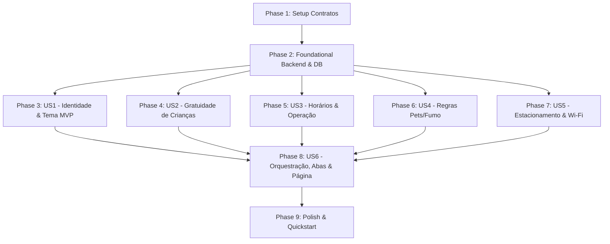

# Tasks: Configurações > Hotel (Aplicação Web)

**Input**: Design documents from `specs/028-hotel-settings/` (plan.md, spec.md, research.md, data-model.md, contracts/hotel_configuracao_contract.ts, quickstart.md)

**Prerequisites**: plan.md, spec.md, data-model.md, contracts/

**Tests**: Testes automatizados incluídos conforme padrão TDD do HotelMind (testes unitários com in-memory fakes, testes de rotas com Fastify inject e testes frontend com RTL e MSW).

**Organization**: Tarefas agrupadas por fases de infraestrutura e por histórias de usuário para entrega incremental e validação independente.

## Format: `[ID] [P?] [Story] Description`

- **[P]**: Pode rodar em paralelo (arquivos distintos, sem dependências bloqueantes)
- **[Story]**: História de usuário associada ([US1] a [US6])
- Caminhos absolutos/relativos ao monorepo especificados em todas as tarefas

---

## Phase 1: Setup (Contratos Compartilhados & Infraestrutura)

**Purpose**: Definição dos tipos compartilhados e registro de rotas no ecossistema

- [X] T001 Criar contratos TypeScript em `packages/.contracts/src/hotel_configuracao.ts` definindo `CategoriaHotel`, `ParkingType`, `ParkingCovered`, `WifiType`, `HotelConfiguracaoDTO` e `UpdateHotelConfiguracaoInput`
- [X] T002 Exportar contratos de hotel em `packages/.contracts/src/index.ts`
- [X] T003 [P] Atualizar seed de rotas do sistema em `packages/api/src/db/seeds/routes_seed.ts` adicionando `{ modulo: 'Configurações', recurso: 'Hotel', rota: '/configuracoes/hotel', icone: 'Settings', ordem: 50 }`
- [X] T004 [P] Mapear o ícone `Settings` da biblioteca `lucide-react` em `packages/web/src/components/layout/Sidebar.tsx` e atualizar `packages/web/src/components/layout/Sidebar.spec.tsx`

---

## Phase 2: Foundational (Persistência, Domínio & API Backend)

**Purpose**: Infraestrutura de dados, entidade de domínio, repositórios, casos de uso e rotas da API que bloqueiam o frontend

**⚠️ CRITICAL**: Nenhuma tela ou componente pode ser integrado antes da conclusão desta fase

- [X] T005 Atualizar o schema do Prisma em `packages/api/src/prisma/schema.prisma` adicionando a relação `configuracao HotelConfiguracao?` no modelo `Hotel` e criando o modelo `HotelConfiguracao` com `@@map("hoteis_configuracoes")` e `@@index([hotel_id])`, contendo:
  - Identidade: `categoria` varchar(50) default "HOTEL", `classificacao_estrelas` int default 0, `descricao_curta` varchar(160) nullable, `descricao_completa` text nullable, `logo_primary` text nullable, `logo_dark` text nullable, `favicon` text nullable, cores HEX varchar(7) (`color_primary` default "#1e40af", `color_secondary` default "#64748b", `color_background` default "#ffffff", `color_surface` default "#f8fafc", `color_text_primary` default "#0f172a", `color_text_secondary` default "#475569", `color_accent` default "#f59e0b")
  - Crianças (apenas gratuidades): `free_child_age_limit` int default 5, `free_child_max_per_room` int default 1
  - Operação: `checkin_time` varchar(5) default "14:00", `checkout_time` varchar(5) default "12:00", `reception_24h` boolean default true, `reception_opening_time` varchar(5) nullable, `reception_closing_time` varchar(5) nullable
  - Políticas (Pets e Fumo): `pet_friendly` boolean default false, `pet_max_weight_kg` decimal(5,2) nullable, `smoking_allowed` boolean default false, `smoking_sanitization_fee` decimal(10,2) nullable
  - Serviços (Estacionamento & Wi-Fi): `parking_type` varchar(30) default "NAO_POSSUI", `parking_fee_per_day` decimal(10,2) nullable, `parking_reservation_required` boolean default false, `parking_covered` varchar(20) default "DESCOBERTO", `wifi_available` boolean default true, `wifi_type` varchar(30) default "GRATUITO_TOTAL", `wifi_ssid_default` varchar(100) nullable, `wifi_password_default` varchar(100) nullable, `wifi_show_on_voucher` boolean default true
- [X] T006 Gerar cliente Prisma e aplicar migração do banco com `pnpm --filter api db:generate` e `pnpm --filter api db:migrate`
- [X] T007 [P] Escrever testes unitários da entidade de domínio `HotelConfiguracao` em `packages/api/src/core/entities/hotel_configuracao.spec.ts` validando cores regex `^#([0-9a-fA-F]{3}|[0-9a-fA-F]{6})$` e obrigatoriedade de horários de recepção quando `reception_24h = false`
- [X] T008 [P] Implementar a entidade de domínio `HotelConfiguracao` em `packages/api/src/core/entities/hotel_configuracao.ts`
- [X] T009 [P] Criar a interface do repositório em `packages/api/src/core/repositories/hotels/hotel_configuracao_repository.ts` com métodos `findByHotelId(hotelId: string): Promise<HotelConfiguracao | null>` e `upsert(hotelId: string, data: UpdateHotelConfiguracaoInput): Promise<HotelConfiguracao>`
- [X] T010 [P] Implementar repositório fake em memória em `packages/api/src/core/repositories/hotels/in-memory/in_memory_hotel_configuracao_repository.ts`
- [X] T011 Implementar repositório Prisma Postgres em `packages/api/src/core/repositories/hotels/implementation/postgres_hotel_configuracao_repository.ts` sincronizando `Hotel.nome_fantasia`, `Hotel.razao_social` e `Hotel.cnpj` durante o `upsert`
- [X] T012 [P] Escrever testes unitários do caso de uso `GetHotelConfiguracaoUseCase` em `packages/api/src/core/usecases/hotels/get_hotel_configuracao_use_case.spec.ts`
- [X] T013 Implementar o caso de uso `GetHotelConfiguracaoUseCase` em `packages/api/src/core/usecases/hotels/get_hotel_configuracao_use_case.ts` retornando configuração existente ou defaults seguros associados ao hotel ativo
- [X] T014 [P] Escrever testes unitários do caso de uso `UpdateHotelConfiguracaoUseCase` em `packages/api/src/core/usecases/hotels/update_hotel_configuracao_use_case.spec.ts`
- [X] T015 Implementar o caso de uso `UpdateHotelConfiguracaoUseCase` em `packages/api/src/core/usecases/hotels/update_hotel_configuracao_use_case.ts`
- [X] T016 [P] Definir esquemas Zod de entrada e saída em `packages/api/src/schemas/hotels/hotel_configuracao_schemas.ts`
- [X] T017 [P] Escrever testes de integração das rotas web em `packages/api/src/routes/hotels/web/hotel_configuracao_routes.spec.ts` cobrindo `GET /hoteis/configuracao` (200 autenticado, 401 desautenticado) e `PUT /hoteis/configuracao` (200 com payload atualizado, 400 com erro de validação)
- [X] T018 Implementar as rotas Fastify em `packages/api/src/routes/hotels/web/hotel_configuracao_routes.ts` com `onRequest: [app.authenticate]` derivando estritamente `request.user.hotelId`
- [X] T019 Registrar o plugin `hotel_configuracao_routes` em `packages/api/src/plugins/fastify_routes.ts`
- [X] T020 [P] Implementar hook cliente TanStack Query em `packages/web/src/hooks/useHotelConfiguracao.ts` com `useQuery({ queryKey: ['hotel-configuracao'] })` e `useMutation` para atualização com invalidação do cache
- [X] T021 [P] Criar esquema Zod do frontend e tipos de formulário em `packages/web/src/schemas/hotel_configuracao.ts` derivado dos contratos compartilhados

**Checkpoint**: Camada de persistência, regras de negócio, endpoints e hooks clientes 100% prontos e testados.

---

## Phase 3: User Story 1 - Identidade Visual, Branding & Tema com Preview (Priority: P1) 🎯 MVP

**Goal**: Permitir a parametrização de logotipos, favicon, paleta de cores e dados institucionais, com preview em tempo real no card de demonstração.

**Independent Test**: Modificar as cores no seletor e verificar que o card de demonstração atualiza suas cores dinamicamente (sub-100ms) e que os campos institucionais (nome, razão, CNPJ, categoria, estrelas, descrições) são preenchidos e validados.

- [X] T022 [P] [US1] Escrever testes unitários do componente `PreviewTemaCard` em `packages/web/src/components/hotel-configuracao/preview_tema_card.spec.tsx` verificando renderização com tokens de cor primária, secundária, fundo, superfície e texto
- [X] T023 [P] [US1] Implementar o componente `PreviewTemaCard` em `packages/web/src/components/hotel-configuracao/preview_tema_card.tsx` utilizando CSS custom properties inline para atualizar botões, badges e superfícies simuladas
- [X] T024 [P] [US1] Escrever testes unitários do componente `AbaIdentidadeVisual` em `packages/web/src/components/hotel-configuracao/aba_identidade_visual.spec.tsx` cobrindo upload/DataURL de `logo_primary`, `logo_dark`, `favicon`, seletores de cor e dados institucionais (`hotel_name`, `legal_name`, `tax_id`, `category`, `star_rating`, `short_description` máx 160 chars, `full_description`)
- [X] T025 [US1] Implementar o componente `AbaIdentidadeVisual` em `packages/web/src/components/hotel-configuracao/aba_identidade_visual.tsx` integrando os inputs com React Hook Form e exibindo o `PreviewTemaCard` lado a lado

**Checkpoint**: Aba 1 e Live Preview funcionais e testados de forma isolada.

---

## Phase 4: User Story 2 - Políticas de Gratuidade de Crianças (Priority: P1)

**Goal**: Configurar a idade limite de gratuidade de crianças e o limite de crianças gratuitas por quarto.

**Independent Test**: Configurar limites de gratuidade (`free_child_age_limit` e `free_child_max_per_room`) e verificar a validação de números inteiros não negativos.

- [X] T026 [P] [US2] Escrever testes unitários de `AbaCriancasHospedes` em `packages/web/src/components/hotel-configuracao/aba_criancas_hospedes.spec.tsx`
- [X] T027 [US2] Implementar `AbaCriancasHospedes` em `packages/web/src/components/hotel-configuracao/aba_criancas_hospedes.tsx` com campos de gratuidade (`free_child_age_limit`, `free_child_max_per_room`)

**Checkpoint**: Aba 2 funcional e validada.

---

## Phase 5: User Story 3 - Horários Operacionais de Check-in, Check-out e Recepção (Priority: P2)

**Goal**: Parametrizar horários padrão de check-in e check-out, bem como o regime de funcionamento da recepção (24 horas ou horário específico).

**Independent Test**: Alterar horários de check-in/out e alternar recepção 24h para horário fixo, verificando a obrigatoriedade dos horários de abertura/fechamento.

- [X] T028 [P] [US3] Escrever testes unitários de `AbaHorariosOperacao` em `packages/web/src/components/hotel-configuracao/aba_horarios_operacao.spec.tsx`
- [X] T029 [US3] Implementar `AbaHorariosOperacao` em `packages/web/src/components/hotel-configuracao/aba_horarios_operacao.tsx` contendo horários (`checkin_time`, `checkout_time`) e recepção (`reception_24h`, `reception_opening_time`, `reception_closing_time`)

**Checkpoint**: Aba 3 funcional com controle condicional de horários de recepção.

---

## Phase 6: User Story 4 - Regras de Convivência (Pets e Fumo) (Priority: P2)

**Goal**: Definir regras relativas a animais de estimação (pet friendly com limite de peso) e proibição de fumo com taxa de higienização.

**Independent Test**: Ativar política pet friendly preenchendo peso máximo em kg, e definir permissão de fumo e taxa de sanitização.

- [X] T030 [P] [US4] Escrever testes unitários de `AbaRegrasCasa` em `packages/web/src/components/hotel-configuracao/aba_regras_casa.spec.tsx`
- [X] T031 [US4] Implementar `AbaRegrasCasa` em `packages/web/src/components/hotel-configuracao/aba_regras_casa.tsx` abrangendo política pet (`pet_friendly`, `pet_max_weight_kg`) e fumo (`smoking_allowed`, `smoking_sanitization_fee`)

**Checkpoint**: Aba 4 funcional com regras de convivência e sanitização.

---

## Phase 7: User Story 5 - Serviços Operacionais (Estacionamento & Wi-Fi) (Priority: P3)

**Goal**: Parametrizar opções de estacionamento e conectividade de rede Wi-Fi com senha protegida e exibição em voucher.

**Independent Test**: Configurar estacionamento pago com valor diário e tipo de cobertura; cadastrar SSID e senha de Wi-Fi com botão de revelar/ocultar senha e toggle de exibição em voucher.

- [X] T032 [P] [US5] Escrever testes unitários de `AbaEstacionamentoWifi` em `packages/web/src/components/hotel-configuracao/aba_estacionamento_wifi.spec.tsx`
- [X] T033 [US5] Implementar `AbaEstacionamentoWifi` em `packages/web/src/components/hotel-configuracao/aba_estacionamento_wifi.tsx` abrangendo estacionamento (`parking_type`, `parking_fee_per_day`, `parking_reservation_required`, `parking_covered`) e Wi-Fi (`wifi_available`, `wifi_type`, `wifi_ssid_default`, `wifi_password_default` com toggle de visibilidade de senha, `wifi_show_on_voucher`)

**Checkpoint**: Aba 5 operacional com proteção de credenciais de rede e regras de estacionamento.

---

## Phase 8: User Story 6 - Navegação Unificada por Abas, Barra Fixa de Ações e Descarte (Priority: P1)

**Goal**: Orquestrar todas as 5 abas em uma experiência integrada com barra inferior fixa, persistência compartilhada em memória entre as abas e botões de salvar/descartar alterações.

**Independent Test**: Editar campos em abas distintas, verificar permanência dos dados ao navegar entre abas, testar botão "Descartar alterações" (reversão aos valores originais) e botão "Salvar alterações" (gravação atômica com Toast de sucesso).

- [X] T034 [P] [US6] Escrever testes unitários do componente `BarraAcoesFixa` em `packages/web/src/components/hotel-configuracao/barra_acoes_fixa.spec.tsx` validando botões "Descartar alterações" e "Salvar alterações", estado de loading e desabilitação
- [X] T035 [P] [US6] Implementar o componente `BarraAcoesFixa` em `packages/web/src/components/hotel-configuracao/barra_acoes_fixa.tsx` com layout fixo inferior, alinhamento à direita e indicador de progresso no salvamento
- [X] T036 [P] [US6] Escrever testes unitários do orquestrador `HotelConfiguracaoForm` em `packages/web/src/components/hotel-configuracao/hotel_configuracao_form.spec.tsx`
- [X] T037 [US6] Implementar o componente orquestrador `HotelConfiguracaoForm` em `packages/web/src/components/hotel-configuracao/hotel_configuracao_form.tsx` integrando as 5 abas (`Tabs`, `TabsList`, `TabsTrigger`, `TabsContent`), formulário unificado React Hook Form e `BarraAcoesFixa`
- [X] T038 [P] [US6] Escrever testes de integração da página em `packages/web/src/pages/app/configuracoes/hotel/index.spec.tsx` com MSW, cobrindo carregamento dos dados iniciais, transição de abas e envio do formulário com feedback Sonner Toast
- [X] T039 [US6] Implementar a página de rota em `packages/web/src/pages/app/configuracoes/hotel/index.tsx` (estritamente sem componentes locais conforme a regra de ouro do frontend)
- [X] T040 [US6] Registrar a rota `/configuracoes/hotel` em `packages/web/src/routes.tsx` vinculada a `AppLayout`

**Checkpoint**: Funcionalidade completa integrada, validada com testes de ponta a ponta e navegável via menu.

---

## Phase 9: Polish & Cross-Cutting Concerns

**Purpose**: Verificação de conformidade, linters, types e execução do guia de validação rápida

- [X] T041 Executar e validar o guia ponta a ponta descrito em `specs/028-hotel-settings/quickstart.md`
- [X] T042 [P] Executar checagem de tipos e lint em todo o monorepo com `pnpm exec biome check .` e `pnpm --filter web typecheck`
- [X] T043 Executar suíte completa de testes com `pnpm --filter api test` e `pnpm --filter web test`

---

## Dependencies & Execution Order

### Phase Dependencies



### User Story Dependencies

- **US1 (P1)**: Depende exclusivamente da Fase 2 (Foundational). Pode ser desenvolvida em paralelo às outras abas.
- **US2, US3, US4, US5**: Dependem da Fase 2 (Foundational) e dos contratos compartilhados. Podem ser implementadas em paralelo.
- **US6 (P1)**: Conecta todos os componentes de abas (US1 a US5) no orquestrador unificado, na barra de ações e na página de rota oficial.

---

## Parallel Execution Examples

### Execução Paralela da Fase 1 & 2 (Setup e Backend)
```bash
# Contratos e seed em paralelo:
T001: "packages/.contracts/src/hotel_configuracao.ts"
T003: "packages/api/src/db/seeds/routes_seed.ts"
T004: "packages/web/src/components/layout/Sidebar.tsx"

# Entidade, Repositório e Casos de Uso em paralelo:
T007: "packages/api/src/core/entities/hotel_configuracao.spec.ts"
T010: "packages/api/src/core/repositories/hotels/in-memory/in_memory_hotel_configuracao_repository.ts"
T012: "packages/api/src/core/usecases/hotels/get_hotel_configuracao_use_case.spec.ts"
T014: "packages/api/src/core/usecases/hotels/update_hotel_configuracao_use_case.spec.ts"
```

### Execução Paralela dos Componentes das Abas (Fases 3 a 7)
```bash
# Componentes das 5 abas podem ser desenvolvidos e testados em paralelo:
T024: "packages/web/src/components/hotel-configuracao/aba_identidade_visual.tsx"
T027: "packages/web/src/components/hotel-configuracao/aba_criancas_hospedes.tsx"
T029: "packages/web/src/components/hotel-configuracao/aba_horarios_operacao.tsx"
T031: "packages/web/src/components/hotel-configuracao/aba_regras_casa.tsx"
T033: "packages/web/src/components/hotel-configuracao/aba_estacionamento_wifi.tsx"
```

---

## Implementation Strategy

### MVP First (Fase 1 + Fase 2 + US1)
1. Concluir Setup e Fundação (Persistência, Domínio e API REST);
2. Implementar a Aba 1 com Live Preview de temas;
3. Validar e demonstrar o tema funcionando em tempo real.

### Entrega Incremental
1. Adicionar Abas 2, 3, 4 e 5 simplificadas;
2. Integrar tudo na Fase 8 com a barra fixa e persistência atômica compartilhada;
3. Rodar validação final `quickstart.md` e linting completo.
