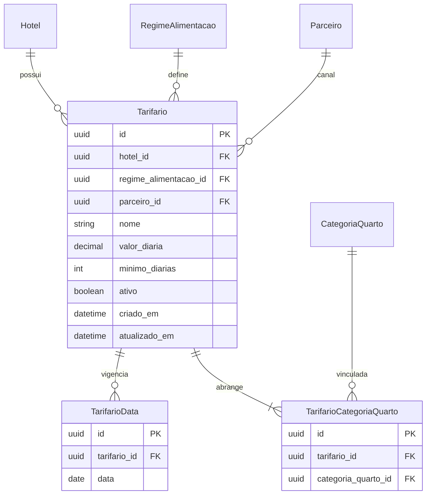

# Data Model: Seleção Multi-Categoria e Estadia Mínima

## Entidades e Relacionamentos

### 1. Tarifario

Representa o plano tarifário aplicável a datas específicas e a uma ou mais categorias de quarto.

| Campo | Tipo | Nulo | Descrição |
|---|---|---|---|
| `id` | UUID (PK) | Não | Identificador único |
| `hotel_id` | UUID (FK) | Não | Identificador do hotel (tenant) |
| `regime_alimentacao_id` | UUID (FK) | Não | Regime de alimentação associado |
| `parceiro_id` | UUID (FK) | Sim | Parceiro comercial (canal) ou nulo para Reserva Direta |
| `nome` | VarChar(100) | Não | Nome descritivo do tarifário |
| `valor_diaria` | Decimal(12,2)| Não | Valor padrão da diária em reais |
| `minimo_diarias` | Integer | Não | Quantidade mínima de noites para reserva (default 1) |
| `ativo` | Boolean | Não | Situação ativa/inativa (default true) |
| `criado_em` | DateTime | Não | Data de criação |
| `atualizado_em` | DateTime | Não | Data de última atualização |

### 2. TarifarioCategoriaQuarto (Nova Tabela Associativa)

Associa o tarifário a múltiplas categorias de acomodações (`tarifarios_categorias_quartos`).

| Campo | Tipo | Nulo | Descrição |
|---|---|---|---|
| `id` | UUID (PK) | Não | Identificador único do vínculo |
| `tarifario_id` | UUID (FK) | Não | Referência a `Tarifario` (`onDelete: Cascade`) |
| `categoria_quarto_id` | UUID (FK) | Não | Referência a `CategoriaQuarto` (`onDelete: Restrict`) |

**Constraints**:
- `@@unique([tarifario_id, categoria_quarto_id])`
- `@@index([tarifario_id])`
- `@@index([categoria_quarto_id])`

### 3. TarifarioData (Existente)

Associa o tarifário às datas de calendário (`tarifarios_datas`).

| Campo | Tipo | Nulo | Descrição |
|---|---|---|---|
| `id` | UUID (PK) | Não | Identificador único |
| `tarifario_id` | UUID (FK) | Não | Referência a `Tarifario` (`onDelete: Cascade`) |
| `data` | Date | Não | Data específica do calendário (YYYY-MM-DD) |

**Constraints**:
- `@@unique([tarifario_id, data])`
- `@@index([tarifario_id])`
- `@@index([data])`

---

## Diagrama de Relacionamento (ERD)

