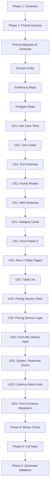

# Tasks: Seleção Multi-Categoria, Estadia Mínima e Máscara Monetária nos Tarifários

**Input**: Design documents from `/specs/029-rate-plan-categories-min-stay/`
**Prerequisites**: [plan.md](plan.md), [spec.md](spec.md), [research.md](research.md), [data-model.md](data-model.md), [contracts/](contracts/tarifarios.contract.md)

## Organization: Tasks by User Story & Execution Order

- **[P]**: Tarefas paralelizáveis (arquivos distintos sem dependências entre si).
- **[US1]**: User Story 1 - Etapa Dedicada com Seleção Multi-Categoria via Cards Padrões.
- **[US2]**: User Story 2 - Definição e Validação de Estadia Mínima (Quantidade Mínima de Diárias).
- **[US3]**: User Story 3 - Máscara Monetária Precisa e Amigável no Campo de Valor.

---

## Phase 1: Setup & Shared Contracts

**Purpose**: Definir tipagens TypeScript compartilhadas antes de qualquer implementação.

- [X] T001 Atualizar contratos de tarifários em `packages/.contracts/src/tarifarios.ts` incluindo `categoria_quarto_ids: string[]`, `categorias: CategoriaQuartoResumo[]`, `minimo_diarias: number` e tipagens de retrocompatibilidade.

---

## Phase 2: Foundational (Database & Domain Models)

**Purpose**: Infraestrutura de banco de dados, migração relacional e camada de repositório.

- [X] T002 Atualizar `packages/api/src/prisma/schema.prisma` adicionando a tabela associativa `TarifarioCategoriaQuarto` (`tarifarios_categorias_quartos`) e o campo `minimo_diarias Int @default(1)` no modelo `Tarifario`.
- [X] T003 Gerar e aplicar a migração Prisma com script em `packages/api` e executar `pnpm --filter api exec prisma generate`.
- [X] T004 Atualizar a entidade de domínio `Tarifario` em `packages/api/src/core/entities/tarifario.ts` e seus testes unitários em `packages/api/src/core/entities/tarifario.spec.ts`.
- [X] T005 [P] Atualizar contrato de repositório e implementação in-memory em `packages/api/src/core/repositories/tarifarios/tarifario.repository.ts` e `packages/api/src/core/repositories/tarifarios/in-memory/in_memory_tarifario_repository.ts`.
- [X] T006 Atualizar repositório PostgreSQL Prisma em `packages/api/src/core/repositories/tarifarios/implementation/postgres_tarifario_repository.ts` para persistir e consultar múltiplos vínculos de categorias e `minimo_diarias`.

---

## Phase 3: User Story 1 - Seleção Multi-Categoria com Cards Padronizados (Priority: P1) 🎯 MVP

**Goal**: Permitir selecionar uma ou mais categorias ativas no tarifário através de uma etapa dedicada (Passo 2) com cards padronizados da área de reservas/orçamentos.

**Independent Test**: Acessar `/tarifarios/novo`, preencher dados básicos no Passo 1, selecionar 2 categorias via cards no Passo 2, definir datas/valor e salvar. O tarifário deve ser registrado e associado a ambas as categorias.

### Backend - Casos de Uso e Rotas (TDD)
- [X] T007 [US1] Criar testes unitários para múltiplos `categoria_quarto_ids` em `packages/api/src/core/usecases/tarifarios/tarifarios_use_cases.spec.ts`.
- [X] T008 [US1] Atualizar `criar_tarifario_use_case.ts` e `editar_tarifario_use_case.ts` em `packages/api/src/core/usecases/tarifarios/` para gravar vínculos multi-categoria e validar ausência de sobreposição por categoria.
- [X] T009 [US1] Atualizar schemas de validação Zod da API em `packages/api/src/schemas/tarifarios/tarifarios_schema.ts` e testes em `tarifarios_schema.spec.ts`.
- [X] T010 [US1] Atualizar rotas e testes de integração Fastify em `packages/api/src/routes/tarifarios/tarifarios_routes.ts` e `packages/api/src/routes/tarifarios/tarifarios_routes.spec.ts`.

### Frontend - Schemas, Componentes e Páginas (TDD)
- [X] T011 [US1] Atualizar schemas e validações do formulário em `packages/web/src/schemas/tarifarios/tarifario_schema.ts` com suporte a `categoria_quarto_ids: z.array(z.string()).min(1)`.
- [X] T012 [P] [US1] Implementar componente `TarifarioCategoryCards` em `packages/web/src/components/tarifarios/tarifario_category_cards.tsx` com testes em `tarifario_category_cards.spec.tsx` espelhando cards de suítes de orçamentos/reservas com multi-seleção e ações de selecionar/desmarcar todas.
- [X] T013 [US1] Refatorar `TarifarioForm` em `packages/web/src/components/tarifarios/tarifario_form.tsx` criando a seção contínua com ícone "Passo 2: Categorias de Quarto" e testes em `tarifario_form.spec.tsx`.
- [X] T014 [US1] Atualizar páginas de criação e edição em `packages/web/src/pages/app/tarifarios/novo.tsx` e `packages/web/src/pages/app/tarifarios/[id]/editar.tsx`.
- [X] T015 [US1] Atualizar tabela e listagem de tarifários em `packages/web/src/pages/app/tarifarios/index.tsx` para apresentar as categorias vinculadas a cada tarifário.

**Checkpoint**: User Story 1 (MVP) 100% funcional e testável de ponta a ponta.

---

## Phase 4: User Story 2 - Definição e Validação de Estadia Mínima (Priority: P2)

**Goal**: Permitir estipular a quantidade mínima de diárias no tarifário e validar sua exigência no motor de precificação e orçamentos/reservas.

**Independent Test**: Configurar tarifário com estadia mínima de 2 diárias para datas específicas. Tentar orçar 1 diária para esse período e verificar que a tarifa é rejeitada ou sinalizada com aviso de estadia mínima não atingida.

### Backend
- [X] T016 [US2] Escrever testes unitários em `packages/api/src/core/services/tarifario_pricing_service.spec.ts` validando restrição de estadia mínima (`minimo_diarias`).
- [X] T017 [US2] Implementar a verificação de `minimo_diarias` no `TarifarioPricingService` em `packages/api/src/core/services/tarifario_pricing_service.ts`.

### Frontend
- [X] T018 [US2] Adicionar campo numérico com label "Quantidade mínima de diárias" (mínimo 1, valor padrão 1) no Passo 5 de `packages/web/src/components/tarifarios/tarifario_form.tsx`.
- [X] T019 [US2] Atualizar lógica de cálculo e visualização de acomodações em `packages/web/src/pages/app/reservas/orcamentos/novo.tsx` e `packages/web/src/pages/app/reservas/nova.tsx` para sinalizar restrição de estadia mínima quando `nights.length < tarifario.minimo_diarias`.

**Checkpoint**: Regra de diárias mínimas ativa e garantida nas reservas e orçamentos.

---

## Phase 5: User Story 3 - Máscara Monetária Precisa no Input de Valor (Priority: P3)

**Goal**: Garantir máscara de digitação amigável em Real brasileiro (`R$ 0,00`) no campo de valor da diária, normalizando para decimal numérico sem falhas.

**Independent Test**: Digitar `15000` no campo de valor da diária e conferir exibição instantânea `R$ 150,00`. Submeter e confirmar persistência com valor decimal `150.00`.

- [X] T020 [P] [US3] Implementar hook utilitário de máscara monetária brasileira em `packages/web/src/hooks/use_currency_mask.ts` e testes unitários em `packages/web/src/hooks/use_currency_mask.spec.ts`.
- [X] T021 [US3] Integrar a máscara de moeda no campo de valor da diária em `packages/web/src/components/tarifarios/tarifario_form.tsx` substituindo o input numérico cru e atualizando testes em `tarifario_form.spec.tsx`.

---

## Phase 6: Polish, Verification & Quality Gate

**Purpose**: Verificação cruzada, testes integrados de regressão e validação com linter Biome.

- [X] T022 Executar checagem de formatação e linting do Biome em todo o repositório (`pnpm exec biome check packages/.contracts packages/api packages/web`).
- [X] T023 Executar suites completas de testes dos pacotes afetados (`pnpm --filter @hotelmind/contracts test`, `pnpm --filter api test`, `pnpm --filter web test`).
- [X] T024 Validar cenários do guia de execução em `specs/029-rate-plan-categories-min-stay/quickstart.md`.

---

## Dependencies & Execution Order

